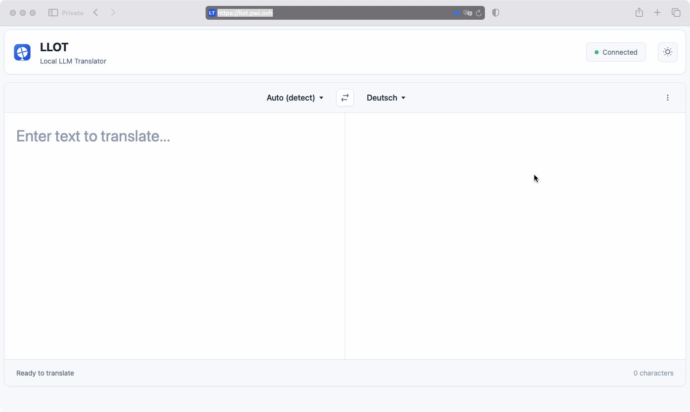

# 🌐 LLOT - Local LLM Ollama Translator

> **Privacy-first AI translation service powered by local LLM models**  
> ✨ No API keys • No cloud services • No data collection • 100% self-hosted ✨

[](https://github.com/pawelwiejkut/llot)
[](https://github.com/pawelwiejkut/llot)
[](https://github.com/pawelwiejkut/llot)

---

## 🎬 Live Demo


*Live demonstration: Real-time translation, language switching, tone selection, and dark mode*

---

## ✨ Why Self-Hosters Love LLOT

| 🔒 **Complete Privacy** | ⚡ **Lightning Performance** | 🏠 **Homelab Perfect** |
|:---:|:---:|:---:|
| Your data never leaves your network | Instant translation with local AI | Docker deployment in 5 minutes |
| Zero cloud dependencies | Real-time as-you-type translation | Uses your existing Ollama server |
| No external API calls | Smart language auto-detection | Lightweight Python Flask app |

| 🌍 **38 Languages** | 🔊 **Neural TTS** | 🎛️ **Full Control** |
|:---:|:---:|:---:|
| Major world languages supported | High-quality speech synthesis | Choose your AI models |
| Auto language detection | Any Wyoming TTS server | Configurable tone & style |
| European languages included | Voices auto-discovered | Your hardware, your rules |

---

## 🚀 Quick Start

### Prerequisites

- Docker with **Docker Compose v2** (plugin) — `docker compose version`
- A running [Ollama](https://ollama.com) server with at least one model pulled

### 🎯 Option 1: Use Your Existing Ollama Server
```bash
git clone https://github.com/pawelwiejkut/llot.git
cd llot

# Configure your Ollama server (and optionally a Wyoming TTS server)
cp .env.example .env
nano .env   # set OLLAMA_HOST, OL_MODEL, WYOMING_TTS_HOST/PORT

# Start LLOT
docker compose up -d

# Access at http://localhost:8080
```

### 🔧 Option 2: Standalone with Everything Included
```bash
git clone https://github.com/pawelwiejkut/llot.git
cd llot

# Includes Ollama + Wyoming Piper TTS + LLOT
docker compose -f docker-compose.full.yml up -d

# Access at http://localhost:8080
# First run will download models (may take time)
```

That's it! 🎉 **Your private translation service is running.**

---

## 🎛️ Key Features

- ✅ **Real-time translation** as you type with smart debounce
- ✅ **38 languages** with auto-detection
- ✅ **Multiple tones** (formal, casual, technical, etc.)
- ✅ **Think mode** — enable/disable chain-of-thought reasoning per request
- ✅ **Dynamic model switching** — change Ollama model on the fly
- ✅ **Text-to-speech** for pronunciation
- ✅ **Dark/light theme** toggle
- ✅ **Mobile responsive** design
- ✅ **Translation history** and word alternatives

---

## 🧠 Think Mode

LLOT supports **Think mode** for reasoning-capable models (e.g. `gemma4`, `qwen3`).

Toggle **Think: Yes / No** in the options panel:

| | Think: No | Think: Yes |
|---|---|---|
| Speed | ~3x faster | Slower |
| Tokens used | Response only | Reasoning + response |
| Best for | Short, common phrases | Complex or ambiguous text |

Think mode is sent to Ollama's `/api/chat` endpoint via the `think` parameter. Models without reasoning support reject it, so LLOT automatically retries those requests with thinking disabled.

---

## 🔧 Requirements

### Minimum System Requirements
- **RAM**: 16GB+ (32GB+ recommended for 27B+ models)
- **Storage**: 20GB+ free space for models
- **CPU**: Any modern CPU (ARM64/AMD64 supported)
- **Docker**: Docker Engine + Compose v2 plugin

### Recommended Setup
- **GPU**: NVIDIA RTX 3090 or better for optimal performance
- **Existing Ollama server** with translation-capable models
- **Optional**: Wyoming Piper for text-to-speech
- **Optional**: Reverse proxy (Nginx, Traefik) for HTTPS

### Recommended Models

| Model | Size | Quality | Think support |
|---|---|---|---|
| `gemma4:26b` | ~18 GB | Excellent | Yes |
| `gemma4:e4b` | ~9 GB | Very good | Yes |
| `gemma3:27b` | ~17 GB | Excellent | No |
| `qwen3:14b` | ~9 GB | Very good | Yes |
| `qwen2.5:14b` | ~9 GB | Good | No |

---

## 🌐 Supported Languages

**Major languages**: English, Chinese, Spanish, French, German, Italian, Portuguese, Russian, Japanese, Korean, Arabic, Hindi, Polish, Dutch, and 24 more.

**Auto-detection**: Automatically detects input language, or choose manually from dropdown.

**Language filtering**: Configure only the languages you need via environment variables.

---

## 🔊 Text-to-Speech

LLOT speaks to any server implementing the [Wyoming protocol](https://github.com/OHF-Voice/wyoming):

- [wyoming-piper](https://github.com/rhasspy/wyoming-piper) (local Piper voices, default port `10200`)
- [wyoming_openai](https://github.com/roryeckel/wyoming_openai) (proxy to OpenAI-compatible TTS such as Speaches/Kokoro, default port `10300`)
- anything else that answers Wyoming `describe` / `synthesize`

Voices are **discovered automatically** from the server. For languages the server has no voice
for, LLOT falls back to the browser's built-in speech synthesis, using **on-device voices only**
(e.g. Safari/macOS/iOS voices) so the text never leaves your machine. The speaker button appears
whenever either source has a voice for the target language. To pin a specific voice, set
`WYOMING_TTS_VOICES=pl=pl_PL-gosia-medium,en=en_US-lessac-medium`.

---

## 🐳 Docker Configuration

### Standard Setup (docker-compose.yml)

`docker-compose.yml` loads your `.env` file into the container, so all configuration
lives in one place:

```yaml
services:
  llot:
    build: .
    ports:
      - "${APP_PORT:-8080}:8080"
    env_file:
      - path: .env
        required: false
    restart: unless-stopped
```

| File | What it starts |
|---|---|
| `docker-compose.yml` | LLOT only (uses your Ollama / TTS servers) |
| `docker-compose.standalone.yml` | LLOT + Ollama |
| `docker-compose.full.yml` | LLOT + Ollama + Wyoming Piper |

### Environment Variables
```bash
# Required
OLLAMA_HOST=http://localhost:11434  # Your Ollama server
OL_MODEL=gemma4:26b                 # Default translation model

# Optional
APP_PORT=8080                       # LLOT port
WYOMING_TTS_HOST=192.168.1.10       # Wyoming TTS server (unset = TTS disabled)
WYOMING_TTS_PORT=10200              # 10200 = wyoming-piper, 10300 = wyoming_openai
WYOMING_TTS_VOICES=pl=pl_PL-gosia-medium  # Pin voices per language
TRANSLATION_LANGUAGES=en,de,pl,cs   # Limit available languages
DEBUG_LOGGING=false                 # Verbose debug output
```

`WYOMING_PIPER_HOST` / `WYOMING_PIPER_PORT` from older versions are still accepted.

### Updating
```bash
scripts/deploy.sh --pull   # pull, test, rebuild, health-check, auto-rollback
```

Prebuilt multi-arch images are published to `ghcr.io/pawelwiejkut/llot`; see
[Production & CI](DOCUMENTATION.md#-production--ci).

> ⚠️ LLOT has no built-in authentication. Expose it only on a trusted network or behind
> a reverse proxy with auth.

---

## 🔌 Ollama API

LLOT uses Ollama's native, current API (checked against Ollama 0.35):

| Endpoint | Used for |
|---|---|
| `POST /api/chat` | All translation work, with `think` for reasoning models |
| `POST /api/chat` + `format` (JSON schema) | Word alternatives and refinement: structured outputs guarantee valid JSON |
| `GET /api/tags` | Model list |
| `POST /api/show` | Model `capabilities`: hides embedding-only models, sends `think` only to models that support it |

Nothing deprecated is used (Ollama's deprecations are `context` on `/api/generate` and the
`typical_p` option). Think mode and capabilities need Ollama 0.9 or newer; with older servers
LLOT falls back to retrying without `think`.

---

## 📚 Documentation

- 📖 **[Complete Documentation](DOCUMENTATION.md)** - Detailed setup, configuration, API docs
- 🧪 **[Testing Guide](DOCUMENTATION.md#-testing--quality)** - How to run tests
- 🔧 **[Development Guide](DOCUMENTATION.md#-development)** - Contributing and local development
- 🌐 **[API Documentation](DOCUMENTATION.md#-api-documentation)** - REST API reference

---

## ⭐ Support the Project

If LLOT helps you achieve translation privacy and independence:

- ⭐ **Star this repository** to show your support
- 🐛 **Report issues** to help improve quality
- 🔧 **Contribute** code or documentation
- 🌍 **Share** with the self-hosting community

---

## 🙏 Acknowledgments

Built with ❤️ for the self-hosting community using:
- **[Ollama](https://ollama.com)** - Local LLM deployment made simple
- **[Wyoming](https://github.com/OHF-Voice/wyoming)** - Open voice protocol used for TTS
- **[Flask](https://flask.palletsprojects.com)** - Robust Python web framework

---

<div align="center">

**🏠 Made for Self-Hosters, by Self-Hosters**

**🔒 Your Data • 🏠 Your Network • ⚡ Your Speed**

[🚀 Quick Start](#-quick-start) • [📖 Documentation](DOCUMENTATION.md) • [🐛 Issues](https://github.com/pawelwiejkut/llot/issues)

</div>
